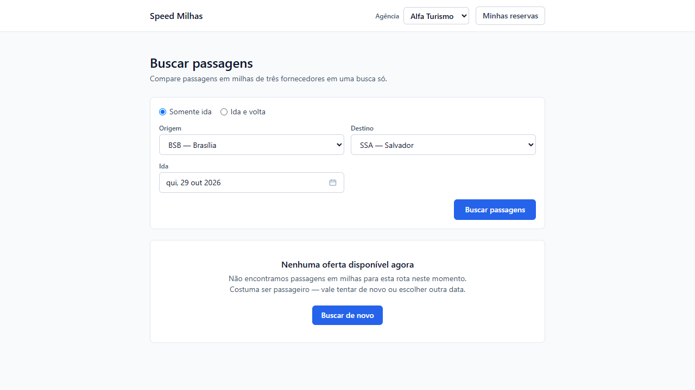

# Bugs

## BUG-01 — Taxa de serviço não segue o arredondamento para cima

- **Local afetado:** resultados da busca, reserva de passagem e detalhe da reserva.
- **Ambiente:** aplicação local, branch main, Google Chrome.
- **Gravidade:** média — diferença no cálculo da taxa e do total em reais.
- **Regra relacionada:** SPEC 2.9 — "A taxa de serviço é 7% da taxa de embarque, arredondada para cima ao centavo."
- **Status:** confirmado após reprodução.

### Pré-condições e dados

- Agências em que o problema foi observado: Alfa Turismo e Beta Viagens.
- Agência utilizada neste exemplo: Alfa Turismo ou Beta Viagens.
- Origem e destino: GRU e GIG.
- Data da viagem: 24/10/2026.
- Fornecedor: GOL.
- Taxa de embarque: R$ 65,77.
- Cálculo sem arredondamento: 65,77 × 0,07 = 4,6039.

### Passos para reproduzir

1. Selecionar uma das agências.
2. Realizar uma busca com rota e data válidas.
3. Localizar uma oferta cujo cálculo evidencie a diferença,
   como a oferta com taxa de embarque de R$ 65,77.
4. Calcular 7% da taxa de embarque, sem arredondamento intermediário.
5. Arredondar o resultado para cima ao centavo.
6. Comparar a taxa e o total esperados com os valores apresentados.
7. Selecionar a oferta e conferir os valores na reserva e no detalhe.

### Resultado esperado

Aplicar o arredondamento para cima ao centavo:

- Taxa de embarque: R$ 65,77.
- Taxa de serviço: R$ 4,61.
- Total em reais: R$ 70,38.

### Resultado obtido

A aplicação apresenta:

- Taxa de embarque: R$ 65,77.
- Taxa de serviço: R$ 4,60.
- Total em reais: R$ 70,37.

### Impacto

A taxa de serviço e o total apresentados ficam R$ 0,01 abaixo
dos valores previstos pela regra de negócio neste exemplo.

### Evidência

## BUG-02 — Consulta usa agência incorreta ao abrir reserva por URL direta

- **Local afetado:** acesso direto ao detalhe da reserva.
- **Ambiente:** aplicação local, branch main, Google Chrome.
- **Gravidade:** alta — apresentação de dados de outra agência.
- **Regra relacionada:** SPEC 4.16 — "Uma agência só vê e consulta as próprias reservas".
- **Status:** reproduzido na exploração manual.

### Pré-condições e dados

- Agência proprietária da reserva: Alfa Turismo.
- Identificador da Alfa: `alfa-turismo`.
- Agência selecionada no acesso: Beta Viagens.
- Identificador da Beta: `beta-viagens`.
- ID da reserva: `6d0397c5-8275-4fff-87f2-d8f9a96d8d4f`.
- Caminho do detalhe: `/reservas/6d0397c5-8275-4fff-87f2-d8f9a96d8d4f`.

O ID identifica a reserva utilizada na reprodução.
Em outro ambiente, criar uma reserva da Alfa e utilizar seu novo ID.

### Passos para reproduzir

1. Selecionar Alfa Turismo.
2. Criar ou abrir uma reserva pertencente à Alfa.
3. Acessar o detalhe e copiar sua URL.
4. Alterar a agência selecionada para Beta Viagens.
5. Acessar a listagem e conferir que a reserva da Alfa não aparece.
6. Acessar diretamente a URL copiada.
7. Conferir a agência selecionada e os dados apresentados.
8. Inspecionar a requisição de consulta no Network do navegador.

### Resultado esperado

A consulta deve utilizar a identificação da agência Beta selecionada
e impedir a apresentação da reserva pertencente à Alfa.

### Resultado obtido

A reserva da Alfa não aparece na listagem da Beta.

Entretanto, ao acessar diretamente sua URL com Beta selecionada,
a consulta utiliza o clienteId da Alfa e apresenta a reserva.

- clienteId esperado para a seleção atual: `beta-viagens`.
- clienteId efetivamente enviado: `alfa-turismo`.

### Impacto

A interface apresenta uma reserva de outra agência,
apesar de indicar Beta como agência selecionada.

### Limite da conclusão

Foi identificada uma divergência entre a agência selecionada
e a identificação enviada na consulta.

Este resultado não comprova, isoladamente, falha no bloqueio da API.
A consulta direta da reserva da Alfa, enviando explicitamente
o identificador da Beta, ainda será testada.

### Evidência

## BUG-03 — Busca na aceita volta anterior à ida, sem aviso ao usuário

- **Local afetado:** formulário de busca de ida e volta.
- **Ambiente:** aplicação local, branch main, Google Chrome.
- **Gravidade:** média — processamento de busca com itinerário inválido.
- **Regra relacionada:** SPEC 1.2 — "Na ida e volta, a data de volta não pode ser anterior à data de ida".
- **Status:** reproduzido na exploração manual.

### Pré-condições e dados

- Agência: Alfa Turismo.
- Origem: GRU.
- Destino: GIG.
- Modalidade: ida e volta.
- Data de ida: 23/10/2026.
- Data de volta: 19/10/2026.
- Data da execução: 19/10/2026.

### Passos para reproduzir

1. Selecionar Alfa Turismo.
2. Selecionar a modalidade de ida e volta.
3. Informar origem GRU e destino GIG.
4. Preencher a ida com 23/10/2026.
5. Preencher a volta com 19/10/2026.
6. Executar a busca.
7. Observar o processamento e as mensagens apresentadas.

### Resultado esperado

Rejeitar a busca com volta anterior à ida, conforme a SPEC,
e informar ao usuário que as datas precisam ser corrigidas.

### Resultado obtido

A aplicação executa a busca normalmente com a volta anterior à ida,
sem apresentar mensagem de validação ou aviso ao usuário.

### Impacto

O usuário consegue executar uma busca com itinerário incompatível
com a regra de negócio, sem orientação para corrigir as datas.

### Limite da conclusão

Foi confirmado o processamento da busca.
A possibilidade de concluir uma reserva com essas datas
não foi estabelecida neste registro.

### Evidência

## BUG-04 — Busca oculta ofertas quando um fornecedor falha

- **Local afetado:** resultados da busca.
- **Ambiente:** aplicação local, branch main, Chrome.
- **Gravidade sugerida:** alta.
- **Regra relacionada:** em caso de falha parcial dos fornecedores,
  manter as ofertas disponíveis e apresentar o aviso
  “Pode haver mais opções para esta data.”
- **Status:** reproduzido por automação E2E.

### Pré-condições e dados

- Mock com fornecedor B configurado para falhar.
- Fornecedor C configurado no modo de taxa nula.
- Agência: Alfa Turismo.
- Modalidade: somente ida.
- Origem: BSB.
- Destino: SSA.
- Data: 29/10/2026.

### Passos para reproduzir

1. Restaurar o mock usando POST /admin/reset.
2. Configurar a falha com POST /admin/force-fail/supplier-b.
3. Configurar C com POST /admin/force-dirty/supplier-c?mode=null.
4. Abrir a aplicação e preencher os dados informados.
5. Executar a busca.
6. Comparar a resposta de /search/stream com o resultado da tela.

### Resultado esperado

Exibir as ofertas retornadas pelos fornecedores disponíveis
e o aviso “Pode haver mais opções para esta data.”

Ofertas com taxa não informada devem aparecer sem permitir reserva.

### Resultado obtido

A resposta da API apresenta status partial e seis ofertas:
quatro do fornecedor A e duas do fornecedor C.
Cinco ofertas possuem bookable: true.
Somente o fornecedor B apresenta status error.

Entretanto, a interface exibe “Nenhuma oferta disponível agora”,
sem apresentar as ofertas nem o aviso de resultado parcial.

### Impacto

O usuário deixa de visualizar e reservar ofertas disponíveis
quando apenas um fornecedor apresenta falha.

### Evidências

- Resposta da busca com status partial e ofertas disponíveis:
  [Resposta de /search/stream](evidencias/bug-04-stream.txt).

- Interface apresentando indisponibilidade:

### Limpeza

Restaurar o mock usando POST /admin/reset.

## BUG-05 — Reserva sem nome do passageiro retorna erro 500

- **Local afetado:** POST /orders.
- **Ambiente:** aplicação local, branch main.
- **Gravidade sugerida:** média.
- **Regra relacionada:** o nome do passageiro é obrigatório;
  pedidos inválidos devem retornar 400 com mensagem explicativa,
  nunca 500.
- **Status:** reproduzido por teste automatizado de API.

### Pré-condições

- Oferta válida e reservável obtida em POST /search.
- Agência informada no header x-client-id: alfa-turismo.
- Chave de idempotência nova.

### Passos para reproduzir

1. Buscar uma oferta reservável.
2. Enviar POST /orders com o quoteId dessa oferta,
   uma nova idempotencyKey e passageiro: {}.
3. Conferir o status e o corpo da resposta.

### Resultado esperado

Status 400 com mensagem informando a obrigatoriedade
do nome do passageiro.

### Resultado obtido

Status 500 com o corpo:

{
  "error": {
    "code": "INTERNAL_ERROR",
    "message": "Erro interno"
  }
}

### Impacto

Uma entrada inválida provoca erro interno e não orienta
o consumidor da API sobre o campo obrigatório ausente.

### Evidências

Saída do terminal e trace do teste
“Recusar reserva sem nome do passageiro”.

## BUG-06 — API permite consultar reserva de outra agência

- **Local afetado:** GET /orders/:id.
- **Ambiente:** aplicação local, branch main.
- **Gravidade sugerida:** alta.
- **Regra relacionada:** uma agência só consulta as próprias
  reservas; consultar uma reserva de outra agência deve retornar 404.
- **Status:** confirmado por teste automatizado de API.

### Pré-condições e dados

- Agência proprietária: alfa-turismo.
- Agência enviada na consulta: beta-viagens.
- ID da reserva: 3419c148-925e-4371-a249-ad368a648149.
- Passageiro: Teste Isolamento QA.

### Passos para reproduzir

1. Criar uma reserva com x-client-id: alfa-turismo.
2. Consultar a reserva com o mesmo cabeçalho e confirmar status 200.
3. Consultar GET /orders/3419c148-925e-4371-a249-ad368a648149
   enviando x-client-id: beta-viagens.
4. Conferir o status e os dados retornados.

Para novas execuções, criar uma reserva e utilizar seu ID.

### Resultado esperado

Retornar status 404, sem apresentar dados da reserva da Alfa.

### Resultado obtido

A API retorna status 200 e os dados da reserva pertencente à Alfa,
mesmo recebendo x-client-id: beta-viagens.

O corpo da resposta contém clientId: alfa-turismo,
nome do passageiro, trecho e valores da reserva.

### Impacto

Uma agência consegue consultar dados de reservas e passageiros
de outra agência conhecendo o identificador da reserva.

### Evidências

Log e trace do teste automatizado:
“Impedir que Beta consulte uma reserva da Alfa”.

### Relação com BUG-02

O BUG-02 registra o comportamento observado pela interface.
Este registro demonstra o acesso diretamente pela API,
enviando explicitamente a identificação da Beta.