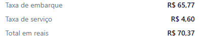
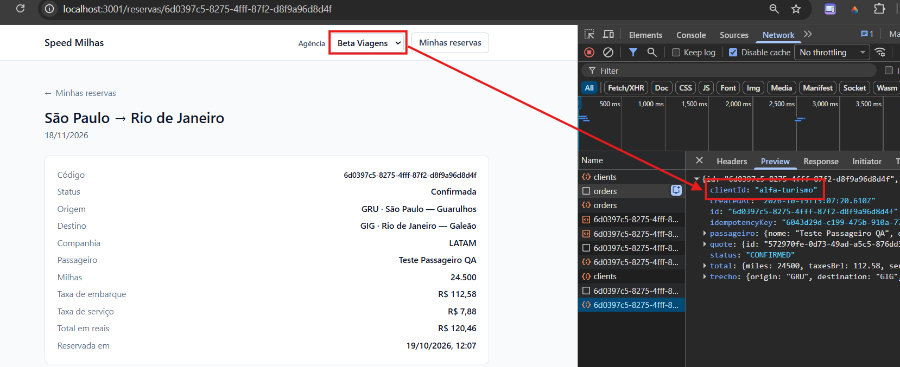
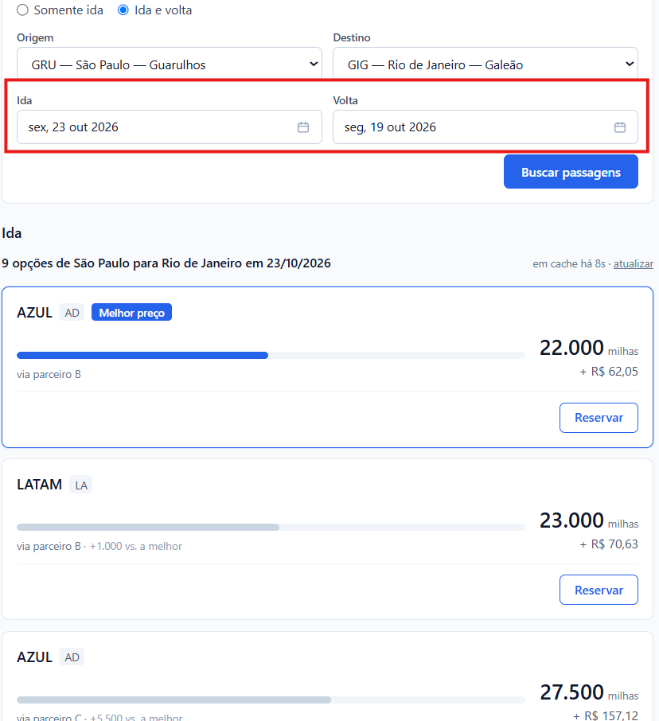

# Bugs

## BUG-01 — Taxa de serviço não segue o arredondamento para cima

- **Local afetado:** resultados da busca, reserva de passagem e detalhe da reserva.
- **Ambiente:** aplicação local, branch main, Google Chrome.
- **Gravidade:** média — diferença no cálculo da taxa e do total em reais.
- **Regra relacionada:** SPEC 2.9 — "A taxa de serviço é 7% da taxa de embarque, arredondada para cima ao centavo."
- **Status:** confirmado após reprodução.

### Pré-condições e dados

- Agências em que o problema foi observado: Alfa Turismo e Beta Viagens.
- Agência utilizada neste exemplo: Alfa Turismo ou Beta Viagens.
- Origem e destino: GRU e GIG.
- Data da viagem: 24/10/2026.
- Fornecedor: GOL.
- Taxa de embarque: R$ 65,77.
- Cálculo sem arredondamento: 65,77 × 0,07 = 4,6039.

### Passos para reproduzir

1. Selecionar uma das agências.
2. Realizar uma busca com rota e data válidas.
3. Localizar uma oferta cujo cálculo evidencie a diferença,
   como a oferta com taxa de embarque de R$ 65,77.
4. Calcular 7% da taxa de embarque, sem arredondamento intermediário.
5. Arredondar o resultado para cima ao centavo.
6. Comparar a taxa e o total esperados com os valores apresentados.
7. Selecionar a oferta e conferir os valores na reserva e no detalhe.

### Resultado esperado

Aplicar o arredondamento para cima ao centavo:

- Taxa de embarque: R$ 65,77.
- Taxa de serviço: R$ 4,61.
- Total em reais: R$ 70,38.

### Resultado obtido

A aplicação apresenta:

- Taxa de embarque: R$ 65,77.
- Taxa de serviço: R$ 4,60.
- Total em reais: R$ 70,37.

### Impacto

A taxa de serviço e o total apresentados ficam R$ 0,01 abaixo
dos valores previstos pela regra de negócio neste exemplo.

### Evidência

## BUG-02 — Consulta usa agência incorreta ao abrir reserva por URL direta

- **Local afetado:** acesso direto ao detalhe da reserva.
- **Ambiente:** aplicação local, branch main, Google Chrome.
- **Gravidade:** alta — apresentação de dados de outra agência.
- **Regra relacionada:** SPEC 4.16 — "Uma agência só vê e consulta as próprias reservas".
- **Status:** reproduzido na exploração manual.

### Pré-condições e dados

- Agência proprietária da reserva: Alfa Turismo.
- Identificador da Alfa: `alfa-turismo`.
- Agência selecionada no acesso: Beta Viagens.
- Identificador da Beta: `beta-viagens`.
- ID da reserva: `6d0397c5-8275-4fff-87f2-d8f9a96d8d4f`.
- Caminho do detalhe: `/reservas/6d0397c5-8275-4fff-87f2-d8f9a96d8d4f`.

O ID identifica a reserva utilizada na reprodução.
Em outro ambiente, criar uma reserva da Alfa e utilizar seu novo ID.

### Passos para reproduzir

1. Selecionar Alfa Turismo.
2. Criar ou abrir uma reserva pertencente à Alfa.
3. Acessar o detalhe e copiar sua URL.
4. Alterar a agência selecionada para Beta Viagens.
5. Acessar a listagem e conferir que a reserva da Alfa não aparece.
6. Acessar diretamente a URL copiada.
7. Conferir a agência selecionada e os dados apresentados.
8. Inspecionar a requisição de consulta no Network do navegador.

### Resultado esperado

A consulta deve utilizar a identificação da agência Beta selecionada
e impedir a apresentação da reserva pertencente à Alfa.

### Resultado obtido

A reserva da Alfa não aparece na listagem da Beta.

Entretanto, ao acessar diretamente sua URL com Beta selecionada,
a consulta utiliza o clienteId da Alfa e apresenta a reserva.

- clienteId esperado para a seleção atual: `beta-viagens`.
- clienteId efetivamente enviado: `alfa-turismo`.

### Impacto

A interface apresenta uma reserva de outra agência,
apesar de indicar Beta como agência selecionada.

### Limite da conclusão

Foi identificada uma divergência entre a agência selecionada
e a identificação enviada na consulta.

Este resultado não comprova, isoladamente, falha no bloqueio da API.
A consulta direta da reserva da Alfa, enviando explicitamente
o identificador da Beta, ainda será testada.

### Evidência

## BUG-03 — Busca aceita volta anterior à ida, sem aviso ao usuário

- **Local afetado:** formulário de busca de ida e volta.
- **Ambiente:** aplicação local, branch main, Google Chrome.
- **Gravidade:** média — processamento de busca com itinerário inválido.
- **Regra relacionada:** SPEC 1.2 — "Na ida e volta, a data de volta não pode ser anterior à data de ida".
- **Status:** reproduzido na exploração manual.

### Pré-condições e dados

- Agência: Alfa Turismo.
- Origem: GRU.
- Destino: GIG.
- Modalidade: ida e volta.
- Data de ida: 23/10/2026.
- Data de volta: 19/10/2026.
- Data da execução: 19/10/2026.

### Passos para reproduzir

1. Selecionar Alfa Turismo.
2. Selecionar a modalidade de ida e volta.
3. Informar origem GRU e destino GIG.
4. Preencher a ida com 23/10/2026.
5. Preencher a volta com 19/10/2026.
6. Executar a busca.
7. Observar o processamento e as mensagens apresentadas.

### Resultado esperado

Rejeitar a busca com volta anterior à ida, conforme a SPEC,
e informar ao usuário que as datas precisam ser corrigidas.

### Resultado obtido

A aplicação executa a busca normalmente com a volta anterior à ida,
sem apresentar mensagem de validação ou aviso ao usuário.

### Impacto

O usuário consegue executar uma busca com itinerário incompatível
com a regra de negócio, sem orientação para corrigir as datas.

### Limite da conclusão

Foi confirmado o processamento da busca.
A possibilidade de concluir uma reserva com essas datas
não foi estabelecida neste registro.

### Evidência

